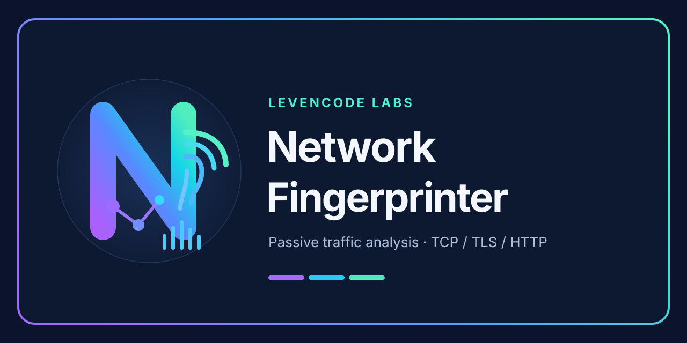

# Network Fingerprinter

**Пассивный фингерпринтинг сетевого трафика: от локального PCAP до результата в браузере.**

[Русский](README.ru.md) · [English](README.md) · **[Руководство пользователя](USERGUIDE.ru.md)** · [User guide](USERGUIDE.md) · [Эксплуатация Docker](docs/docker.md) · [Levencode Labs](https://github.com/levencode-labs)

Network Fingerprinter выделяет из сетевого трафика признаки TCP, TLS и HTTP для анализа TCP-потоков и отпечатков ОС/приложений. Система состоит из необязательного **Sensor** (выборочный захват через TShark), **Collector** на Elasticsearch 8 и веб-приложения **Analyst** для импорта записанного трафика, просмотра потоков и статистики. **Для первого запуска перехват трафика не нужен.**

> **Актуализация: ноябрь 2026.** Единый Docker Compose в корне, Elasticsearch/Kibana **8.19.25**, PostgreSQL **16.16**, Analyst на **Node.js 24**. Проверена локальная демонстрационная конфигурация; это не готовая защищённая production-система.

## Первый результат: импорт PCAP

Потребуются Docker Engine с Compose v2 (или Docker Desktop с **Linux-контейнерами**), не менее **4 ГиБ** памяти для Docker и свободные локальные порты **3000**, **5601**, **9200**.

1. Клонируйте репозиторий, откройте терминал в его корне и запустите стандартный профиль. Отдельные Compose-файлы модулей и ручная инициализация БД не нужны:

   ```sh
   git clone https://github.com/AlexanderLevenskikh/network-fingerprinter.git
   cd network-fingerprinter
   docker compose --env-file .env.example up -d --build
   docker compose --env-file .env.example ps -a
   ```

2. Дождитесь состояния healthy у `analyst`, `postgres`, `elasticsearch` и `kibana`; одноразовые `elastic-init` и `kibana-init` должны завершиться успешно. Откройте **[Analyst](http://127.0.0.1:3000)**. При *пустом* томе PostgreSQL вход: пользователь **`admin`**, пароль **`local-admin-change-me`** из [`.env.example`](.env.example).
3. На экране **Player / загрузка PCAP** выберите или перетащите файл **PCAP** (до **10 МиБ на файл**) с TCP SYN/SYN-ACK, TLS ClientHello либо HTTP-сообщениями. Для каждого файла показываются **обработка**, **число успешно проиндексированных пакетов**, **нет подходящих пакетов (0)** или **ошибка**. После ошибки загрузку можно повторить; постоянной истории импортов нет.
4. Перейдите в **TCP-потоки**: здесь видны соединения, адреса и доступные отпечатки. В **Статистике** есть сводки по клиентам и серверам. Корректный PCAP без подходящих пакетов импортируется с результатом 0 и не создаёт поток; повреждённый файл показывает ошибку.

**Нет PCAP?** На Linux/macOS с Python 3 после готовности сервисов запустите из корня репозитория **синтетический smoke-тест**:

```sh
APP_ADMIN_PASSWORD=local-admin-change-me python3 tests/smoke_analyst.py
```

В PowerShell: `$env:APP_ADMIN_PASSWORD='local-admin-change-me'; python tests/smoke_analyst.py`. Скрипт **сам импортирует синтетические пакеты в локальный стенд** (2 SYN/SYN-ACK, 102 пакета через границу фрагментов, 0 совпадений, ошибки и повтор) и создаёт `tests/browser_retry.pcap`. Откройте **Player / загрузка PCAP**, загрузите созданный файл, посмотрите результат для него и перейдите к **TCP-потокам**. Адреса в примере принадлежат зарезервированным тестовым диапазонам TEST-NET. Этот сценарий проверен в [Linux E2E](.github/workflows/analyst-e2e.yml); запуск Python-команды в Windows отдельно не проверен E2E. Для других файлов используйте только разрешённые к анализу захваты. Подробности — в [контракте импорта](docs/pcap-import.md).

Тестовые пароли и HTTP-сервисы по умолчанию доступны **только на loopback**. Не публикуйте их в локальной сети или интернете. Для постоянного **локального** стенда скопируйте `.env.example` в игнорируемый Git файл `.env`, замените **все** примерные пароли и `SESSION_SECRET`, затем запускайте `docker compose up -d --build`. Администратор создаётся Analyst при старте с пустой таблицей пользователей, сразу с современным scrypt; для существующей базы пароль не меняется. См. [аудит безопасности и восстановление администратора](docs/SECURITY_AUDIT.md).

## Компоненты

| Компонент | Назначение | Адрес по умолчанию |
| --- | --- | --- |
| **Analyst** | Вход, импорт PCAP, TCP-потоки, статистика | [127.0.0.1:3000](http://127.0.0.1:3000) |
| **Collector** | Индексы пакетов в Elasticsearch 8.19.25 и представление `packets-*` в Kibana 8.19.25 | [Kibana 127.0.0.1:5601](http://127.0.0.1:5601); ES `127.0.0.1:9200` |
| **Sensor** (необязательно) | Выборочный экспорт SYN/SYN-ACK, TLS ClientHello, HTTP в Elasticsearch | Захват сетевого интерфейса **только на Linux**, профиль `capture-linux` |

По умолчанию Compose запускается **без Sensor**, поэтому импорт готовых PCAP доступен на Linux и в Docker Desktop для Windows/macOS. Live capture включается **только явно на Linux**: нужен реальный `SENSOR_INTERFACE`, права и разрешение на захват. Сеть виртуальной машины Docker Desktop не равнозначна прямому доступу к физическому интерфейсу хоста. Инструкция — [Linux Sensor](docs/docker.md#live-capture-linux-only-opt-in).

## Хранение, совместимость, ограничения

- Named volumes: **`elasticsearch-data-v8`** и **`postgres-data`**. ES8 использует **новый отдельный том** и не открывает старый `elasticsearch-data` от ES7. **Миграция ES7→ES8 не реализована.** В старом `.env` могут отсутствовать новые секреты Kibana: сверьте с [`.env.example`](.env.example). Не подключайте старые данные ES7 к ES8 и не удаляйте тома, если они нужны.
- В **Linux GitHub Actions** проверены Compose/PG, Analyst API, настоящий Chromium с загрузкой синтетических PCAP и **синтетическая** индексация Sensor→ES8 без захвата физического интерфейса. Windows Docker Desktop — только локальная smoke-проверка (скачивание образов может зависеть от прокси), а **не** пройденный Windows E2E; macOS отдельно не проверена E2E. Live capture с реального интерфейса, большая нагрузка, безопасность production и миграция старых данных **не подтверждены**.
- Analyst работает на Node 24 с совместимостью для старого NestJS 6; во фронтенде остаётся Webpack 4. Патчи в [#95](https://github.com/AlexanderLevenskikh/network-fingerprinter/issues/95) сократили, но не устранили server advisories (в том числе критический TypeORM и высокие Nest/Axios); клиентские зависимости также требуют отдельной работы. Пароли новых пользователей хешируются через асинхронный scrypt, но постоянное хранилище сессий, TLS, rate limiting и другие меры для внешней публикации ещё не реализованы. Обновлённые версии **не означают** сертификат безопасности.

Пошаговый сценарий работы — в **[руководстве пользователя](USERGUIDE.ru.md)**. Диагностика, переменные окружения, порядок инициализации, тома и выключение (включая **опасный** `down -v`) — в [Docker-руководстве](docs/docker.md). Лимиты, HTTP-ответы и частичная индексация при ошибке — в [руководстве по импорту PCAP](docs/pcap-import.md). [Issues](https://github.com/AlexanderLevenskikh/network-fingerprinter/issues) · [CI](https://github.com/AlexanderLevenskikh/network-fingerprinter/actions).

## Лицензия

[Apache License 2.0](LICENSE).
